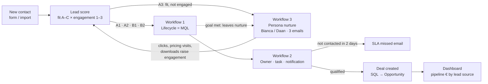
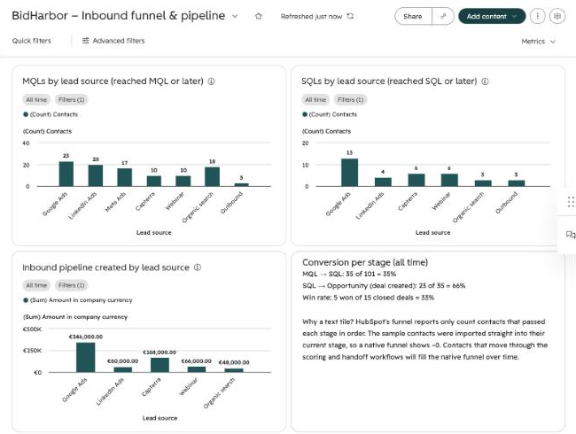
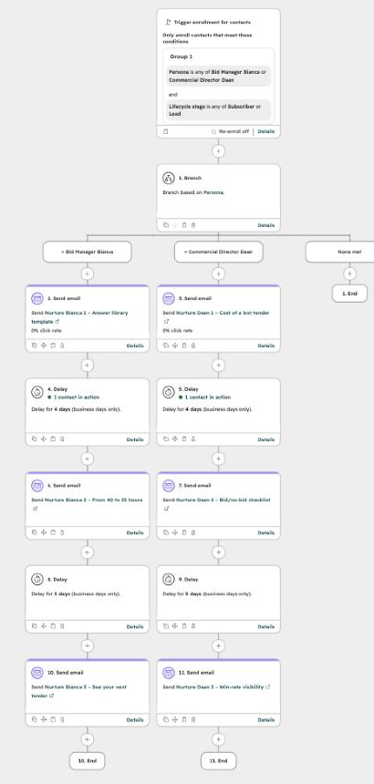
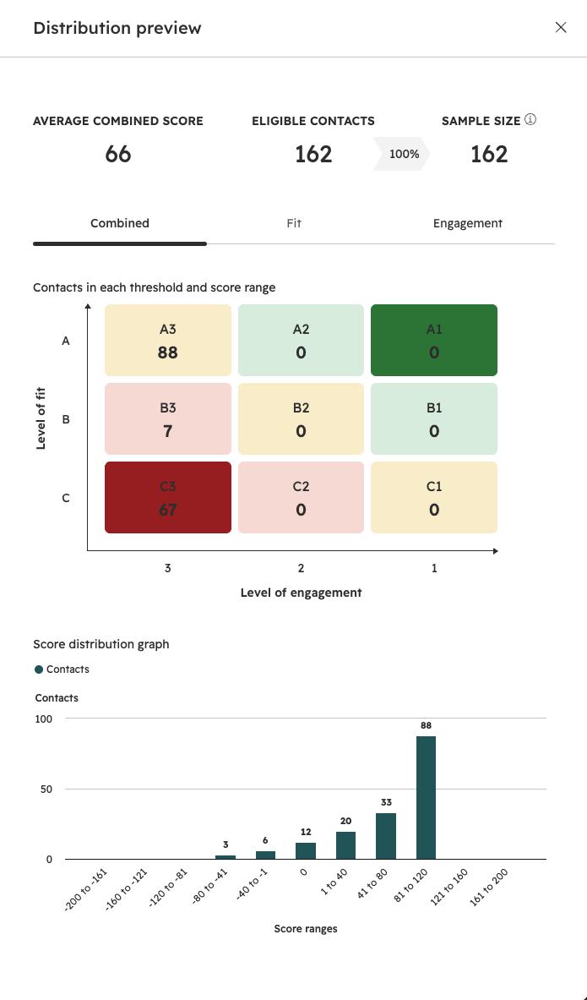
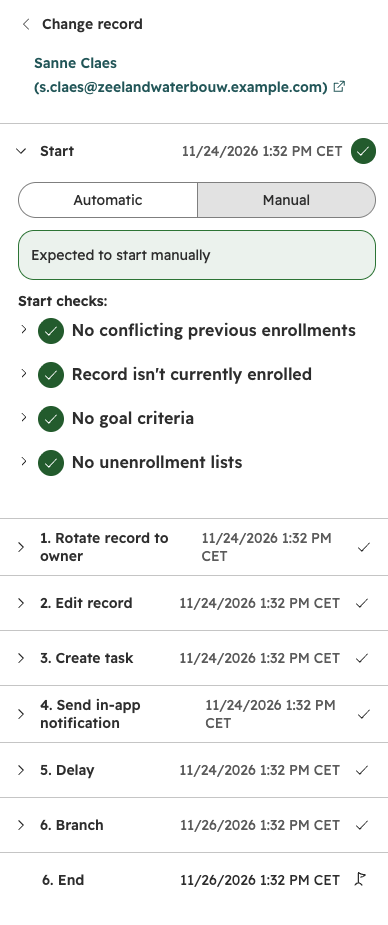
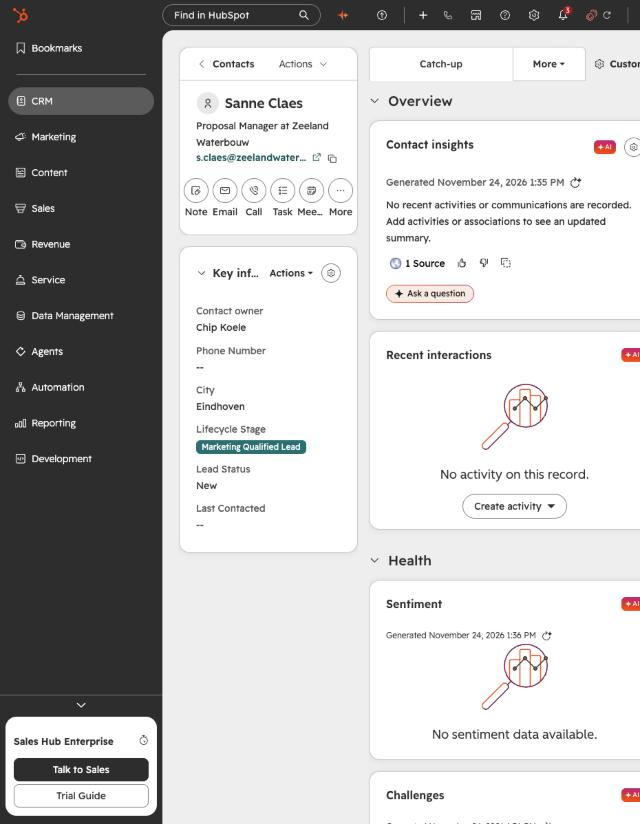
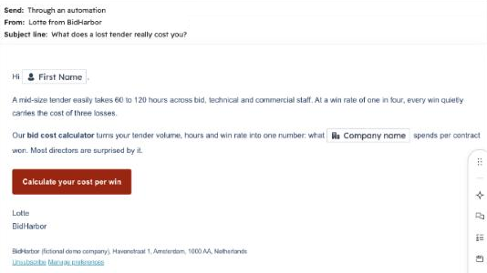

# HubSpot Expert Setup – BidHarbor demo portal

> **Spec work.** BidHarbor is a fictional bid/tender-management SaaS I invented for this build. All 160 contacts, 144 companies and 23 deals are generated sample data on `*.example.com` domains. No real customer data, no real brand.

## Problem

Most B2B teams "use HubSpot" but can't answer three basic pipeline questions:

1. **When is a lead ready for sales?** Marketing and Sales use different definitions, so MQLs get ignored or sales gets flooded.
2. **What happens after the handoff?** No owner, no task, no SLA, so warm leads go cold.
3. **Which channel actually creates pipeline?** Reports stop at form fills, so budget follows volume instead of revenue.

I wanted to show I can set up the whole inbound engine end-to-end, the way a SaaS Growth Lead would: definitions agreed with Sales, scoring, automated handoff, nurture, and reporting on pipeline by source.

## What I built

A HubSpot (Enterprise trial) developer test portal for a fictional company, **BidHarbor** (NL/BE, ACV €30K). ICP: construction, civil engineering, IT services and facility services, 50–1,000 employees. Two personas: **Bid Manager Bianca** and **Commercial Director Daan**.

| Part | What it does |
|---|---|
| **Lifecycle + lead status** | Default lifecycle stages; lead status trimmed to New → Attempted → Connected → Qualified / Unqualified / Bad timing. Custom *Unqualified reason* and *Lead source* properties (same channels as my [Weekly Performance Digest](../weekly-performance-digest/)). |
| **Lead scoring (fit + engagement)** | Fit: industry +25, 50–1,000 employees +25, NL/BE +20, persona +30, "student" −50. Engagement (last 3 months): pricing page, forms, events, email clicks. Matrix A–C × 1–3; **MQL = A1, A2, B1, B2**. |
| **Workflow 1 – MQL from score** | Grade hits A1/A2/B1/B2 while Subscriber/Lead → lifecycle = MQL. Re-enrollment on, so recycled leads can come back. |
| **Workflow 2 – MQL handoff to sales** | Rotate owner → lead status *New* → high-priority call task (due in 1 business day) → in-app notification → after 2 business days, if still *New*: "SLA missed" email. |
| **Workflow 3 – Persona nurture** | 2 tracks × 3 emails (Bianca: time saved per tender; Daan: cost per win, bid/no-bid). Every CTA is a scored action, so engagement moves contacts from A3 towards MQL. **Goal = lifecycle MQL or later:** contacts leave the nurture the moment workflow 2 takes over. |
| **Dashboard** | MQLs by lead source, SQLs by lead source, inbound pipeline (€) by lead source, conversion per stage. |

## How it works

**Why these choices** (the questions a hiring manager asks):

- **Fit and engagement are scored separately.** A perfect-fit Bid Manager who has never visited the site (A3) needs nurture, not a sales call. A student downloading everything (C1) needs neither. A single combined number hides that difference.
- **The MQL trigger only reads the score, never the owner.** The workflow sets the owner itself. Triggering on something the workflow changes creates loops.
- **Existing records were not enrolled** when the handoff and nurture went live. Turning on automation in a live portal shouldn't dump 65 "new" MQLs on sales or email 26 contacts at once.
- **The nurture has a goal, not just an end.** As soon as someone becomes an MQL they stop getting nurture emails. Nobody gets a "see our pricing" email the day after talking to sales.
- **Pipeline is reported in €, by lead source.** MQL volume alone rewards cheap channels (Meta brought 17 MQLs and 0 SQLs). Pipeline by source shows Google Ads (€346K) and Capterra (€168K) actually pay.

## Results (sample data)

| Metric | Value |
|---|---|
| MQLs (reached MQL or later) | 101 |
| SQLs | 35 → **MQL→SQL 35%** |
| Deals created | 23 → **SQL→Opp 66%** |
| Closed deals | 15, of which 5 won → **win rate 33%** |
| Inbound pipeline, top sources | Google Ads €346K · Capterra €168K · Webinar €66K |
| Contacts in the nurture pool (persona, not yet MQL) | 26 |

The story in the data: **Webinar and Capterra convert best, Meta brings volume but no SQLs, Google Ads drives the most pipeline.**

## Demo

| | |
|---|---|
|  |  |
| Dashboard: funnel and pipeline by source | Persona nurture: branch per persona, 3 emails, business-day delays |
|  |  |
| Lead score back-test: 88 contacts in A3 (the nurture pool) | MQL handoff: owner, task, notification, SLA branch |
|  |  |
| Live test: contact after handoff | Nurture email 1 for Daan, with personalisation tokens |

More: [workflow 1 screenshot](../../assets/hubspot-expert-setup_workflow-mql-from-score.png) · [handoff task](../../assets/hubspot-expert-setup_handoff-task-created.jpg) · [dashboard v1](../../assets/hubspot-expert-setup_dashboard-v1.jpg) · [all 6 nurture emails](nurture-emails/nurture-copy.md)

## What I learned

- **Developer test portals don't deliver marketing email** to anyone except the portal's own users. The nurture enrolled and branched correctly in a live test, but the send was blocked ("not allowed in a sandbox or developer test portal"). I verified the content with a test send instead. In a real portal this is a non-issue; in an interview it's a good story about reading error logs instead of guessing.
- **HubSpot funnel reports are sequential.** Imported contacts that skip stages show ~0 conversion, so I reported stage conversion from "reached stage X or later" counts instead.
- **Emails must be "saved for automation"** before a workflow can use them. I created the 6 emails through HubSpot's Marketing Email API and switched them to automated emails.
- **Turning automation on is a decision, not a click.** Enrolling existing records, re-enrollment and goals all change who gets what, and when.
- **Agent Builder (Breeze)** is available in the test portal. Test runs are simulated, use no credits and don't write to the CRM, so agents can be prototyped for free; publishing and live runs need HubSpot Credits.

## Stack

HubSpot Marketing Hub + Sales Hub (Enterprise trial, developer test account) · lead scoring · workflows · marketing email (automated) · custom reports and dashboards · HubSpot Marketing Email API · Python (sample-data generator) · Claude (build partner and copy)

## How to run it

1. Create a free [HubSpot developer account](https://developers.hubspot.com/) and a **developer test account** inside it.
2. Import `sample-data/bidharbor-contacts-companies.csv` (map industry, employees and country to **Company**), then `sample-data/bidharbor-deals.csv` with contacts set to *update existing only*, so deals link by email. Regenerate the data with `python generate_sample_data.py`.
3. Create the properties *Lead source* (contact + deal) and *Unqualified reason*, and the two personas.
4. Rebuild the score with the rules in the table above, then the three workflows. Turn each on **without** enrolling existing records.
5. Build the dashboard reports with filters on "lifecycle stage reached MQL / SQL or later" and "deal amount by lead source".

No API keys or credentials are needed or stored in this repo.
