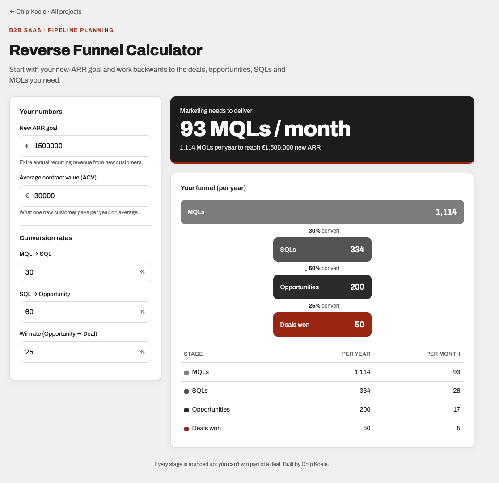
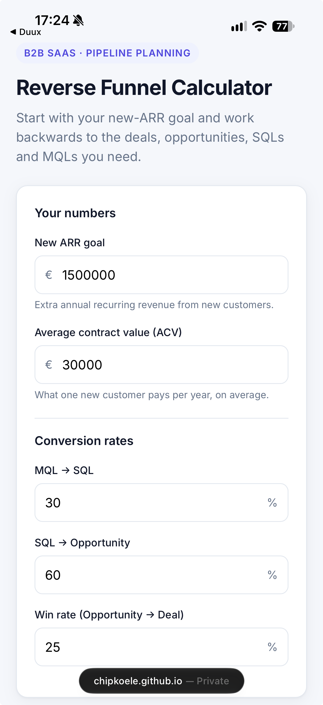

# Reverse Funnel Calculator

> **Status:** 🟢 Live · **Learning module:** A: SaaS and pipeline fundamentals

## Problem
Revenue goals are set in ARR, but marketing works in leads. How many MQLs per month does it take to hit a new-ARR target?

## What I built
A single-page web app that turns a revenue goal into a lead target. You enter a new-ARR goal, the average contract value (ACV) and three conversion rates (MQL → SQL, SQL → opportunity and win rate). The calculator works backwards to show how many deals, opportunities, SQLs and MQLs you need per year and per month, with a funnel visual.

- Results update live as you type
- Rounds up at every stage (you can't win half a deal)
- Works on mobile

## How it works
The calculator starts at the revenue goal and divides by each conversion rate, moving up the funnel:

```
New-ARR goal        €1,500,000
   ÷ ACV            €30,000
   = Deals won           50
   ÷ Win rate           25%
   = Opportunities      200
   ÷ SQL → Opp          60%
   = SQLs               334   (333.3, rounded up)
   ÷ MQL → SQL          30%
   = MQLs             1,114 per year  (~93 per month)
```

## Stack
- Plain HTML, CSS and JavaScript (no frameworks)
- Built with Claude
- Hosted on GitHub Pages

## Demo
🔗 **Live demo:** https://chipkoele.github.io/portfolio/projects/reverse-funnel-calculator/




## Result / what I learned
- I learned to think in a reverse funnel: start from the revenue goal and work backwards, instead of starting from the leads I can generate.
- Each conversion rate is a lever: improving one stage lowers the number of MQLs needed, so better handoff or qualification can matter as much as more leads.
- I took my first steps with Git and GitHub: commits, branches, pull requests and publishing a page with GitHub Pages.

## How to run it
- Open the [live demo](https://chipkoele.github.io/portfolio/projects/reverse-funnel-calculator/), or
- Download `index.html` and open it in any browser. No installation needed.
