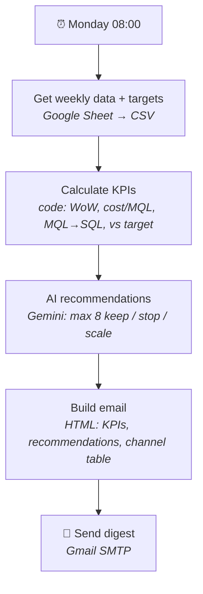
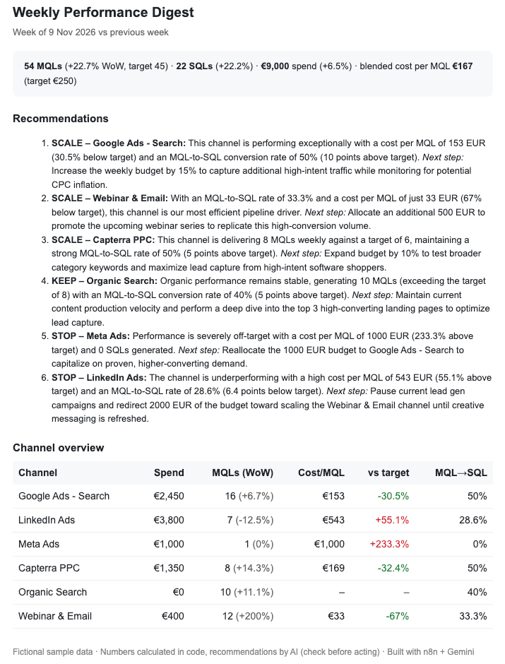

# Weekly Performance Digest (AI agent)

> **Status:** 🟢 Built · **Learning module:** C: AI agents and automations

## Problem
Weekly marketing reviews take hours of pulling numbers from ads, GA4 and HubSpot before anyone decides what to keep, stop or scale. By the time the spreadsheet is ready, the meeting is half over.

## What I built
An n8n workflow that runs every Monday at 08:00 and emails the growth lead a two-minute digest:

- **Pulls last week's data** per channel: spend, clicks (ad platforms), sessions (GA4), form submissions, MQLs and SQLs (HubSpot), plus the targets per channel
- **Calculates in code** week-on-week change, cost per MQL, MQL→SQL % and the gap to target for every channel and in total
- **AI step (Gemini)** turns those numbers into at most 8 **keep / stop / scale** recommendations, each with the numbers behind it and one concrete next step
- **Sends an HTML email** with a KPI summary, the recommendations and a channel table coloured green/red against target

The data is a Google Sheet with 8 weeks of realistic, fictional data for 6 channels. That keeps the demo independent of API access. In production, the sheet would be filled by the ad platforms, GA4 and HubSpot (or replaced by their nodes).

## How it works



**Key design choice: code does the maths, AI does the judgement.** Language models predict text and can miscalculate, so every number is calculated in a Code node first. The AI gets finished numbers, is told not to recalculate, and only decides what to do with them. That's also why the email footer says *"recommendations by AI (check before acting)"*: AI advises, a human decides.

Other choices:
- **"Last week" = the newest week in the sheet**, not today's date, so the demo works any day.
- **Automatic retries** on the AI step (5 tries), because external APIs have busy moments. The model is a setting: when one model was overloaded, I swapped it in seconds.
- **No Google Cloud OAuth setup**: the sheet is read via published CSV links and email goes out via Gmail SMTP with an app password. Fine for fictional data. With real data I'd use the proper Google Sheets and Gmail nodes with OAuth.

## Stack
- **n8n** (self-hosted Community Edition, running in Docker)
- **Google Sheets** as the data source (fictional sample data)
- **JavaScript** Code nodes for the calculations and the email template
- **Google Gemini** (Gemini 3.1 Flash Lite, free tier) for the recommendations
- **Gmail SMTP** for sending
- Built with Claude as developer and teacher

## Demo
🎥 **Loom walkthrough:** _coming soon_

The digest as it lands in the inbox:



## Result / what I learned
- One run turns **48 data rows** (8 weeks × 6 channels) into **one email in ~15–30 seconds**, every Monday, without anyone opening a spreadsheet.
- The AI picked up the story in the data correctly: scale Google Ads and Capterra (cost per MQL ~30% under target), stop Meta (€1,000 per MQL, 0 SQLs) and LinkedIn (€543 vs a €350 target), and copied every number exactly from the code.
- **Workflow vs agent:** a workflow is a fixed recipe (trigger → steps → output); an agent gets a goal and tools and decides its own steps. This is a workflow with one AI step, on purpose: the numbers need to be exact and predictable.
- **Debugging real integrations:** enabling an API in the right Google Cloud project, handling a "model overloaded" error with retries and a model swap, and tracing a Gmail login error back to one missing character in an app password.
- **Credentials hygiene:** API keys and passwords live in n8n's credential store and are not part of the exported workflow; the JSON in this repo has placeholders for the sheet links and email address.

## How to run it
1. **Start n8n** (free, needs [Docker Desktop](https://www.docker.com/products/docker-desktop/)):
   ```bash
   docker volume create n8n_data
   docker run -it --rm --name n8n -p 5678:5678 \
     -e GENERIC_TIMEZONE="Europe/Amsterdam" -e TZ="Europe/Amsterdam" \
     -v n8n_data:/home/node/.n8n docker.n8n.io/n8nio/n8n
   ```
   Open http://localhost:5678 and create the local owner account.
2. **Data:** import [`sample-data/weekly_data.csv`](sample-data/weekly_data.csv) and [`sample-data/targets.csv`](sample-data/targets.csv) into one Google Sheet as two tabs named `weekly_data` and `targets`. Publish each tab as CSV (File → Share → Publish to web → CSV) and copy both links.
3. **Import the workflow:** in n8n, create a new workflow → **⋯ → Import from file** → [`workflow/weekly-performance-digest.json`](workflow/weekly-performance-digest.json).
4. **Fill in the placeholders:** paste your two CSV links into `Get weekly data` and `Get targets`, and your email address into `Send digest`.
5. **Credentials** (see [`.env.example`](.env.example) for the list): add a Google Gemini API key from [aistudio.google.com/apikey](https://aistudio.google.com/apikey) and an SMTP credential (`smtp.gmail.com`, port 465, SSL on, your Gmail address and a [Gmail app password](https://myaccount.google.com/apppasswords)). Never commit these.
6. Click **Execute workflow** to test, then **Publish** to switch on the Monday 08:00 schedule. It only runs while n8n is running; in production, host it on an always-on server or n8n Cloud.

The JavaScript from both Code nodes and the AI prompt are also in [`code/`](code/) for easy reading.
